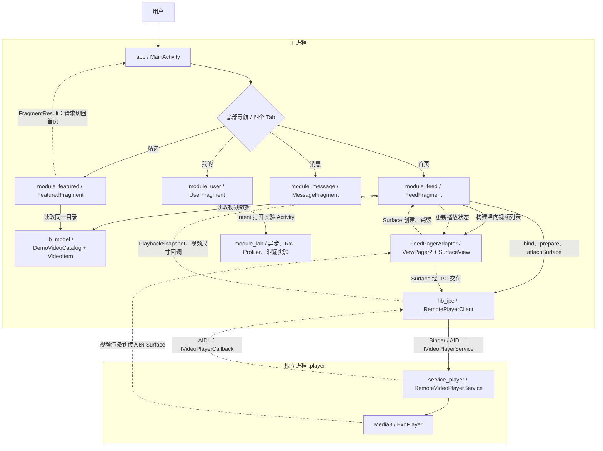
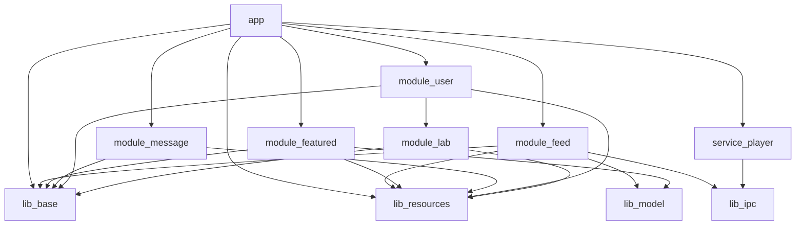
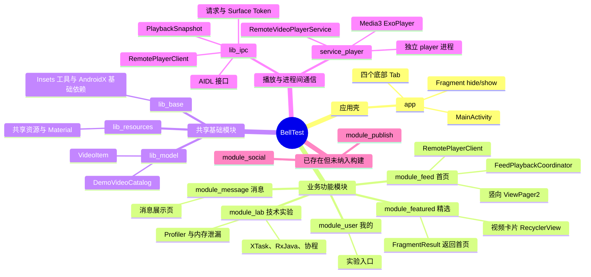

# BellTest 模块协作链路与思维导图

> 分析对象：GitHub `TianDuo-King/BellTest`，`main` 分支，2026-11-10。依据 `settings.gradle.kts`、各模块 `build.gradle.kts` 与关键 Kotlin/AIDL 源码。

## 一、实际运行链路图

**说明**：`module_feed` 通过 `lib_ipc` 而非直接访问 `ExoPlayer`。`service_player` 通过 Gradle 依赖被打包到 `app`，通过 AndroidManifest 声明为 `android:process=":player"` 的 Service。主进程与远程播放器经 Binder/AIDL 双向通信。首页离开 `onStop` 时解绑并释放远程播放资源；返回时重新绑定、尝试恢复播放。

## 二、Gradle 依赖关系图（箭头表示 implementation 依赖）

`lib_base` 的 `api` 暴露 AndroidX Core / AppCompat / Fragment 依赖；`lib_resources` 的 `api` 暴露 Material。`app` 对 `lib_ipc` 另有 `androidTestImplementation`，未在正式运行依赖箭头中展示。`module_publish`、`module_social` 有仓库目录及 Gradle 文件，但没有加入当前 `settings.gradle.kts`。

## 三、模块思维导图

## 四、当前链路中值得注意的细节

1. 精选卡片点击时通过 `setFragmentResult()` 向 `MainActivity` 传递视频 `mediaId`，但 `MainActivity` 目前仅切回首页，**没有消费 `mediaId` 并定位到对应视频**。
2. `app` 通过直接实现依赖引入 `service_player`，但真正的播放调用链是 `module_feed → lib_ipc → service_player`，不能把 Gradle 打包依赖与运行时方法调用混为一谈。
3. `module_publish`、`module_social` 有实际源代码目录，但不属于当前 Gradle 构建包含模块。
4. 主进程与远程进程传递的播放状态为 `PlaybackSnapshot`（Parcelable），跨进程视频输出使用 `Surface`。
5. `module_user → module_lab` 是直接依赖：由 `UserFragment` 使用显式 Intent 打开实验 Activity，而不是通过独立导航协议解耦。

## 五、代码依据

- [模块清单 settings.gradle.kts](https://github.com/TianDuo-King/BellTest/blob/main/settings.gradle.kts)
- [app 依赖](https://github.com/TianDuo-King/BellTest/blob/main/app/build.gradle.kts)
- [主导航 MainActivity.kt](https://github.com/TianDuo-King/BellTest/blob/main/app/src/main/java/com/example/belltest/MainActivity.kt)
- [首页 FeedFragment.kt](https://github.com/TianDuo-King/BellTest/blob/main/module_feed/src/main/java/com/example/belltest/feed/FeedFragment.kt)
- [精选 FeaturedFragment.kt](https://github.com/TianDuo-King/BellTest/blob/main/module_featured/src/main/java/com/example/belltest/featured/FeaturedFragment.kt)
- [IPC RemotePlayerClient.kt](https://github.com/TianDuo-King/BellTest/blob/main/lib_ipc/src/main/java/com/example/belltest/ipc/RemotePlayerClient.kt)
- [播放器 RemoteVideoPlayerService.kt](https://github.com/TianDuo-King/BellTest/blob/main/service_player/src/main/java/com/example/belltest/player/RemoteVideoPlayerService.kt)
- [播放器独立进程声明](https://github.com/TianDuo-King/BellTest/blob/main/service_player/src/main/AndroidManifest.xml)
- [我的 UserFragment.kt](https://github.com/TianDuo-King/BellTest/blob/main/module_user/src/main/java/com/example/belltest/user/UserFragment.kt)
